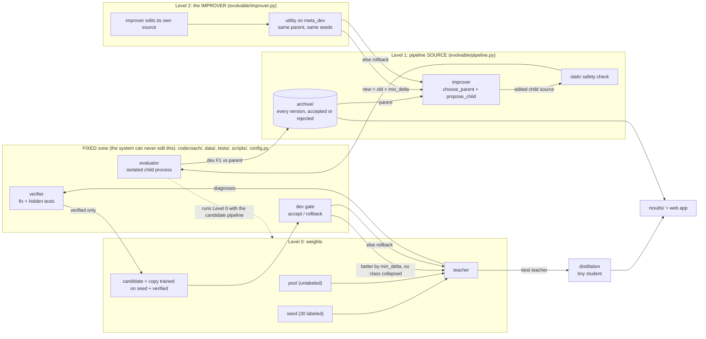

# Architecture

CodeCoach-RSI is **bounded, sandboxed recursive self-improvement**: the system edits only whitelisted files, under a fixed
external evaluator, with rollback. It has three layers plus a compression step.

## Who may read / edit what

| Component | Reads | Writes | Must NOT touch |
|---|---|---|---|
| Teacher / `self_training` (Level 0) | seed (labels), pool `.code`, dev (gate), verdict table | nothing on disk | pool `hidden_label`, test, handwritten |
| Verifier (`verifier.py`) | buggy code, predicted label, problem tests | nothing | model confidence, true label |
| Evaluator (`evaluator.py`) | candidate source, splits (dev, meta_dev), verdicts | `archive/_tmp/` only | **test**, handwritten, any protected file |
| Improver (`evolvable/improver.py`) | accepted versions as plain dicts (id, dev F1) | nothing: returns edited **source strings** | data, labels, files |
| Level 1 loop (`02_evolve.py`) | archive, evaluator results | `archive/` (via `assert_write_allowed`) | `evolvable/`, `codecoach/`, `config.py`, data |
| Level 2 (`Level2` in `02_evolve.py`) | archive, evaluator results on **meta_dev** | `archive/` | the pipeline acceptance decision (that uses dev only) |
| Distillation (`03_distill.py`) | seed, pool, dev (choose T, alpha), test (**report only**) | `results/` | handwritten |
| Final test (`04_final_test.py`) | handwritten cases, saved models | `results/final_test.json`, `FINAL_TEST_DONE` | everything else; runs once |
| Web app | `archive/`, `results/`, splits (live pages) | `archive/live/` (live Level 1 only) | main archive, test, handwritten |

## Data splits (split by problem, 24 problems)

| Split | Problems | Used for | Why separate |
|---|---|---|---|
| train -> seed + pool | 12 | the only labeled data (seed) and unlabeled code the teacher diagnoses (pool) | simulates few labels |
| dev | 4 | Level 0 gates, Level 1 acceptance, (T, alpha) choice | needed to choose |
| meta_dev | 4 | **only** Level 2: judging improvers | the improver must not be judged on data the pipeline was selected on |
| test (synthetic) | 4 | final reporting tables; `03_distill.py` | never used to select anything |
| handwritten | 25+ | `04_final_test.py`, once | different style: the honest generalisation check |

## The editable surface

Only two files, only through `code_editor.py` operators with hard numeric bounds:
`evolvable/pipeline.py` (n-gram range, feature list, hidden layers, learning rate, epochs, rounds, curation strategy) and
`evolvable/improver.py` (operator weights, edits per child, step scale). Versions are written to `archive/vNNN/` and
`archive/improver_vNNN/`, never over the originals.
